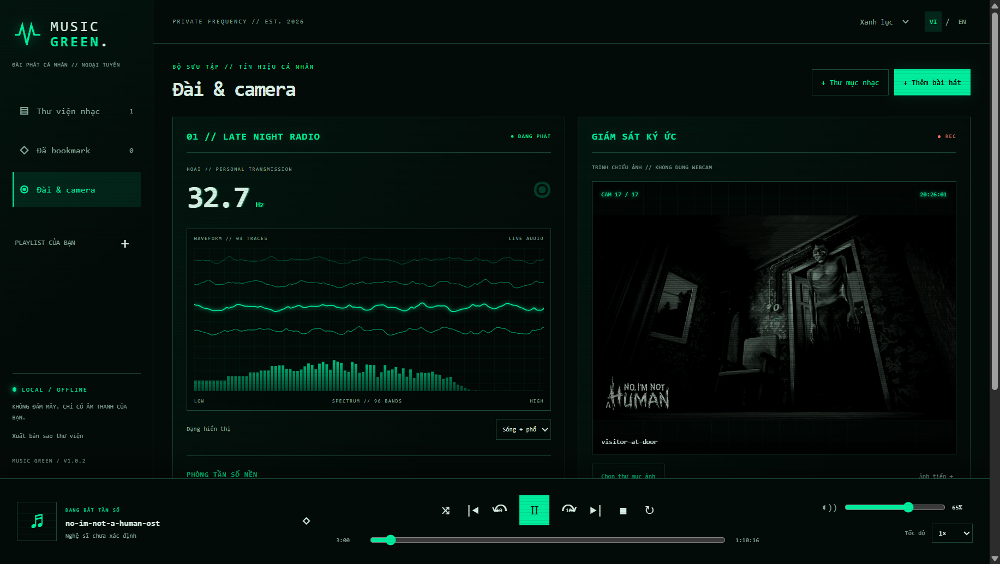
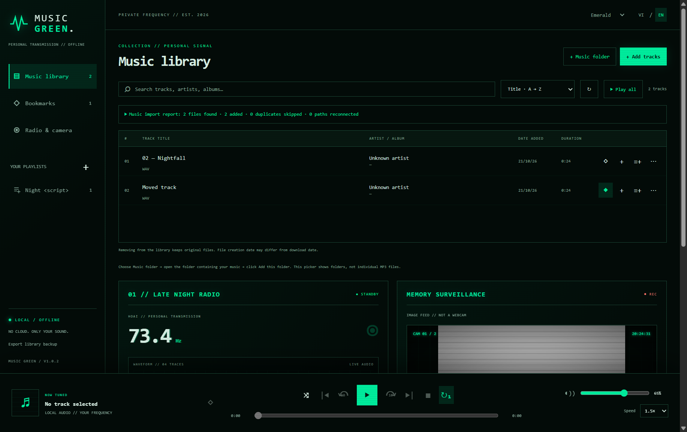
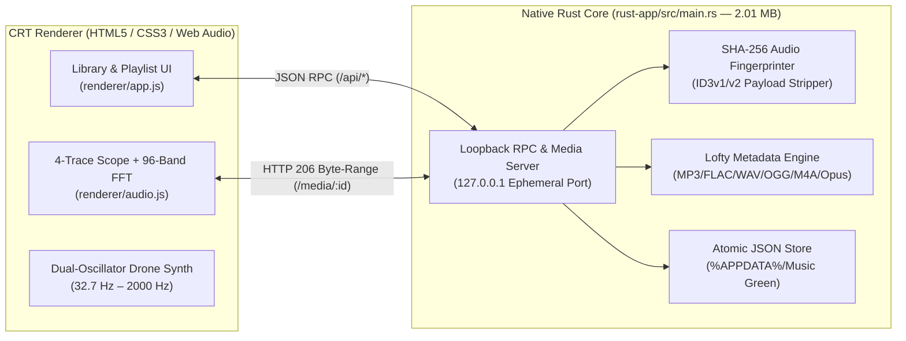

<div align="center">

# ◉ OSCILLA.HZ91- (MUSIC GREEN)

**Ultra-Lightweight Offline CRT Music Player & Personal Frequency Station**  
*Built with a 2.01 MB Native Rust Core, 4-Trace Oscilloscope Visualizer, 96-Band Spectrum Analyzer & Surveillance Memory Feed*

[](https://github.com/hoaipahm/Oscilla.Hz91-)
[](./rust-app)
[](#quick-start--download)
[](#security--privacy-architecture)

</div>

---

## ⚡ Overview

**Oscilla** (*Music Green*) is an offline desktop audio station for Windows 10/11 inspired by late-night phosphor CRT radio equipment and analog oscilloscopes.

Designed to run with **minimal RAM (~5 MB backend footprint)** and zero cloud dependencies, Oscilla ships as a **single 2.01 MB standalone executable (`Oscilla.exe` / `Music Green.exe`)** powered by a native **Rust** backend (`rust-app/`) alongside an optional Electron reference runtime.

---

## 📸 Interface Preview

### 01 // Late Night Radio, 4-Trace Oscilloscope & Memory Surveillance Feed


### 02 // Music Library, SHA-256 Deduplication Report & Collection Manager


---

## 🚀 Key Technical Highlights

| Feature | Technical Implementation |
| :--- | :--- |
| **Ultra-Light Native Rust Binary** | Compiled with `opt-level = "z"`, full LTO (`lto = true`), `codegen-units = 1`, `panic = "abort"`, and symbol stripping into a **2.01 MB** single-file `.exe`. |
| **Real-Time 4-Trace Oscilloscope & 96-Band FFT** | Driven by the Web Audio API (`AnalyserNode`, `fftSize = 4096`, logarithmic 96-band frequency mapping) rendering real PCM time-domain samples at 60 FPS on HTML5 Canvas. |
| **Layered Ambient Frequency Synthesizer** | Built-in dual-oscillator (`triangle` + `sine` detuned ±4 cents) drone synth with low-pass filtering (`BiquadFilterNode`), LFO modulation, and dynamics compression (`32.7 Hz` to `2000 Hz`). |
| **SHA-256 Content & Audio Payload Deduplication** | Computes dual SHA-256 fingerprints (`contentHash` + ID3v1/ID3v2-stripped `audioHash`) so renamed, moved, or re-tagged MP3 files are never duplicated. |
| **Automatic Moved-File Relinking** | When a missing track is re-imported from a new folder or filename, Oscilla matches its SHA-256 fingerprint and transparently relinks the path while preserving its `id`, bookmarks, playlists, and `addedAt` timestamp. |
| **HTTP `206 Partial Content` Byte-Range Streaming** | Streams `MP3`, `FLAC`, `WAV`, `OGG`, `M4A`, `AAC`, `Opus`, and `WebM` directly from disk in 64 KB chunks without buffering whole audio files into RAM. |
| **Memory Surveillance Feed (`CAM REC`)** | Recursively indexes up to 20,000 personal images (`.jpg`, `.png`, `.webp`, `.gif`, `.bmp`, `.avif`) with configurable 5s–120s auto-cycling—100% local, never touching a webcam. |
| **Bilingual & Multi-Phosphor Themes** | Instant runtime switching between **Vietnamese (`VI`)** and **English (`EN`)**, plus 3 CRT phosphor palettes: **Phosphor Green**, **Amber**, and **Ice Blue**. |

---

## 🏗️ System Architecture



---

## 📦 Quick Start & Download

### Option 1: Run the Standalone `.exe` Immediately (No Installation Required)
Download and double-click either standalone executable in the repository root:
- **`Oscilla.exe`** (`2.01 MB` — Native Rust Standalone Edition)
- **`Music Green.exe`** (`2.01 MB` — Native Rust Standalone Edition)

> Works out-of-the-box on any 64-bit Windows 10 or Windows 11 laptop. You can move the single `.exe` file to `Downloads`, `Desktop`, or a USB drive and run it independently.

### Option 2: Build from Source (Rust Native Edition)

**Prerequisites:** Rust (`rustc >= 1.80`, `x86_64-pc-windows-gnu` or `msvc`)

```powershell
# Compile the 2.01 MB optimized release executable
npm run build:rust
# Or directly with Cargo:
cargo build --release --manifest-path rust-app/Cargo.toml
```

### Option 3: Run or Package the Electron Reference Edition

**Prerequisites:** Node.js `>= 22.12`

```powershell
# Run in development mode
npm start

# Run the 18-suite automated test runner
npm test

# Package Electron desktop bundle
npm run build
```

---

## 🎛️ Keyboard Shortcuts & Controls

| Shortcut / Control | Action |
| :--- | :--- |
| `Space` | Play / Pause current track |
| `←` / `→` | Seek backward / forward 10 seconds |
| `Ctrl + O` | Open file picker to import audio tracks |
| `↻` (Repeat) | Cycle repeat mode: **Off → Repeat Queue → Repeat One** |
| `⤨` (Shuffle) | True round-robin shuffle (exhausts all tracks before repeating) |
| `◇ / ◆` | Toggle track bookmark / favorite |
| `0.25× – 2×` | Pitch-preserved playback speed control |

---

## 🔒 Security & Privacy Architecture

- **Zero Telemetry / 100% Offline:** No accounts, no analytics, no external requests.
- **Allowlisted Media Serving:** Only files explicitly imported by the user via native Windows file/folder dialogs are assigned a SHA-256 ID and served over loopback.
- **Non-Destructive Library Management:**
  - *Remove from library* only unlinks the entry from `library.json` without touching the file on disk.
  - *Move to Recycle Bin* prompts a native Windows confirmation dialog displaying the exact file path and uses the Windows Recycle Bin (never permanent deletion).
  - *Corrupted Database Recovery:* If `library.json` is ever damaged, Oscilla automatically preserves a timestamped backup (`library-recovery-<timestamp>.json`) before initializing a clean state.

---

## 📂 Repository Structure

```text
├── Oscilla.exe                # 2.01 MB standalone native Rust executable
├── Music Green.exe            # 2.01 MB standalone native Rust executable
├── app.ico                    # Multi-resolution CRT application icon
├── rust-app/                  # Native Rust backend & desktop host
│   ├── Cargo.toml             # Rust package manifest & size-optimization profile
│   ├── build.rs               # Native PE-COFF (.rsrc) icon compiler in pure Rust
│   ├── window-host.cs         # Native Windows WebView2 host with single-instance mutex
│   └── src/main.rs            # Rust HTTP/206 media streamer, SHA-256 indexer & RPC server
├── renderer/                  # Zero-dependency vanilla JS/CSS CRT frontend
│   ├── index.html             # Application layout & strict CSP header
│   ├── app.js                 # State controller, playlists, queue & surveillance camera
│   ├── audio.js               # Web Audio API 4-trace oscilloscope, 96-band FFT & synth
│   ├── model.js               # Pure sorting, filtering & shuffle algorithms
│   ├── playlist-picker.js     # Multi-select playlist modal controller
│   ├── i18n.js                # Bilingual Vietnamese (VI) & English (EN) dictionary
│   └── styles.css             # Phosphor Green / Amber / Ice CRT styling
├── main.cjs / preload.cjs     # Electron reference main & preload scripts
├── library.cjs / importer.cjs # Reference Node.js SHA-256 fingerprinting & relinking
├── media.cjs                  # Reference HTTP 206 byte-range parser
├── tests/                     # Automated unit & integration test suites
└── docs/screenshots/          # High-resolution interface captures
```

---

## 🇻🇳 Hướng Dẫn Nhanh (Tiếng Việt)

1. **Chạy ngay không cần cài đặt:** Tải file **`Oscilla.exe`** (hoặc **`Music Green.exe`**, chỉ nặng **2.01 MB**) về máy và bấm đúp để mở ngay trên mọi laptop Windows 10/11 (64-bit).
2. **Thêm nhạc & chống trùng thông minh:**
   - Bấm **+ Thêm bài hát** (chọn lẻ nhiều file) hoặc **+ Thư mục nhạc** (quét tự động toàn bộ thư mục con).
   - Bộ lọc băm kép **SHA-256** tự động phát hiện nhạc trùng ngay cả khi bạn đổi tên file hoặc sửa tag ID3, đồng thời tự động **nối lại đường dẫn (relink)** nếu bạn di chuyển file nhạc sang thư mục khác mà không làm mất bookmark hay playlist.
3. **Đài & Camera (`01 // LATE NIGHT RADIO`):**
   - Xem trực tiếp 4 đường sóng âm (Oscilloscope) và phổ âm 96 dải tần theo thời gian thực.
   - Phối thêm các dải tần số nền (`32.7 Hz` – `432 Hz` hoặc tùy chỉnh `20 Hz` – `2000 Hz`) độc lập với nhạc đang phát.
   - Trình chiếu bộ ảnh cá nhân trong khung giám sát `CAM REC` (hoàn toàn ngoại tuyến, không dùng webcam).
4. **Dữ liệu cá nhân an toàn:** Lưu tại `%APPDATA%\Music Green\music-green-data\library.json`. Hỗ trợ sao lưu ra file `.json` bất cứ lúc nào qua nút **Xuất bản sao thư viện**.
